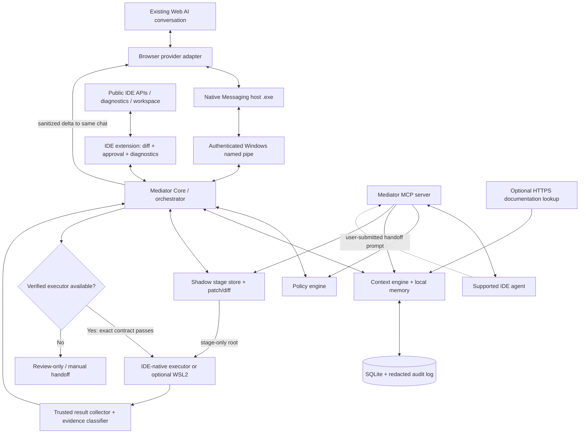

# MEDIATOR — Final Development & Architecture Plan v1.3

**Status:** Revised master specification  
**Revision date:** 10 October 2026  
**Target platform:** Windows 11, Chrome + Microsoft Edge, Antigravity IDE/CLI, VS Code-compatible IDEs  
**Primary use case:** One developer connects an existing browser AI conversation to a local coding workspace, using IDE context and verified native execution/sandbox capabilities where available.  
**Default architecture:** Local-first, TypeScript-first, MCP-aware, adapter-based, fail-closed.  
**Docker:** Not required. Mediator must not install Docker or Podman automatically.

> **Source-of-truth rule:** This document supersedes v1.0, v1.1, and v1.2. This v1.3 document is the sole source of truth. Keep it at the repository root as `Mediator_Final_Development_Plan.md`. Other project docs must align with it. If a coding agent finds a contradiction, it must document the conflict and stop before implementing the contradictory behavior.

## 0. v1.3 review-closure matrix

| Review issue | v1.3 resolution | Primary sections |
|---|---|---|
| 1. Staging path may be outside IDE sandbox | App-data staging is default; executor must prove stage access and live-source write denial. Nested workspace staging is conditional on boundary canaries; otherwise no auto-execution. | 4, 6, Sprints 0/5/10 |
| 2. MCP cannot push commands to IDE agents | IDE-agent path is explicitly manual/pull-based handoff with copy prompt, wait-for-user state, and no automatic routing claim. | 3.3, 16, Sprints 7/11 |
| 3. Agents could self-report tests or approve themselves | Evidence levels distinguish verified execution from agent reports. MCP can request approval but only local IDE UI resolves it. | 3.3, 7, 9 |
| 4. IDE sandbox cannot enforce every recipe guarantee | Every capability records `enforcedBy: mediator | ide | unknown` with evidence; unknown is false. | 4, 12 |
| 5. Protocol lacked action enum and complete example | Allowed action table, canonical status values, envelope example, delimited content block and `request_more_context` are specified. | 7 |
| 6. Native host/IPC details were underspecified | `.exe` host, no `.bat`, current-user named-pipe ACL, pairing token, origin/version checks, 256 KiB chunks and transfer caps are defined. | 3.7, 15 |
| 7. Sprint dependencies were out of order | Minimal IDE shell starts in Sprint 1; diff/approval UI in Sprint 5; ping/pong after browser adapter in Sprint 9. | 17 |
| 8. Sandbox go/no-go was too late | Sprint 0 chooses IDE-native, opt-in WSL2, or Review-only/no-auto-exec. Job Object + restricted token alone is not accepted as filesystem isolation. | 3.4, Sprint 0, Sprint 10 |
| Secret globs and Git worktree assumptions | Expanded secret patterns; worktree is optional and not the default stage backend. | 5, 6, Sprint 2 |
| Modular implementation/debugging | Public module contracts, forbidden import directions, typed errors, correlation IDs, diagnostics dashboard and safe debug bundle are required. | 15.1, 19, 20 |

---

## 1. Product vision

Mediator is a personal development bridge between:

- **Web AI** — the user's existing Gemini, Claude, DeepSeek, or another supported AI chat; this remains the primary reasoning conversation.
- **Browser extension** — detects a supported AI page, reads completed replies, validates conversation identity, and returns sanitized results to the same chat.
- **IDE** — provides workspace understanding, symbols, diagnostics, test discovery, diffs, editor UI, and (where officially exposed) agent-native tools and sandbox execution.
- **Local Mediator Core** — applies policy, binds task state to one conversation, stages changes, controls permissions, stores compact memory, coordinates adapters, and records verifiable evidence.
- **IDE-native agent/sandbox** — preferred route for commands where a supported, verifiable integration exists. Mediator must not claim that a third-party extension can invoke an IDE's internal sandbox unless the IDE provides a documented API, SDK, CLI, or supported agent/MCP path for that operation.
- **Web/research tools** — used for external documentation and current technical facts, with source URLs and retrieved dates retained when useful.

### The user experience

1. Open a project such as `C:\Users\<user>\Desktop\test` in Antigravity or VS Code.
2. Start Mediator from the IDE command palette or CLI.
3. Mediator shows the canonical project path, detected IDE, available features, and the actual execution/sandbox capability status.
4. Open the AI conversation that should do the reasoning. Attach Mediator to that **specific existing conversation**.
5. Mediator prepares a short protocol/priming message with task rules, acceptance criteria, response format, and a per-session nonce.
6. Continue talking to the web AI normally.
7. The AI response is captured only when complete, parsed as a structured proposal, and checked by the Mediator policy engine.
8. Changes are created in a staged task workspace/shadow tree. The IDE displays diffs and project diagnostics.
9. Tests/commands run automatically only when a verified IDE-native/WSL2 adapter can invoke a fixed recipe. If only a pull-based IDE agent is available, Mediator prepares an explicit handoff prompt and waits for the user; otherwise it stays in Review-only mode. It never silently executes in the host shell.
10. Relevant test output, error excerpts, diff summaries, and verification evidence are sanitized and sent into the **same web AI conversation**.
11. The AI continues from that conversation. No new web chat is created between rounds.
12. Mediator stops on verified completion, explicit user stop, identity mismatch, a policy denial, repeated failure, or a resource budget limit.
13. The user reviews and applies the final changes to the original workspace.

### Non-negotiable conversation rule

A task loop and a chat conversation are different things. A new Mediator round must not create a new provider conversation. A new web conversation may be created only when the user selects **New Conversation/Task**, attaches a different conversation, or confirms a handoff because the original conversation can no longer continue. Never silently create a new chat to save context.

---

## 2. Core architecture principle: route each job to the right tool

Mediator should not recreate capabilities that the browser, IDE, or native agent already provides. It should coordinate them through narrow adapters.

| Job | Primary tool | Mediator's responsibility | What Mediator must not do |
|---|---|---|---|
| Understand the feature request, reason, propose implementation | User's existing web AI conversation | Keep the same chat attached and provide only relevant feedback | Create a new chat each round or resend the whole repository |
| Read completed AI output | Browser provider adapter | Wait for completion, identify raw response/code blocks, validate the protocol | Parse a partial streaming response as final |
| Understand project structure | IDE workspace API + incremental local index | Ask for symbols, files, diagnostics, tests, Git state as needed | Dump all files into AI context |
| Get compiler/language diagnostics | IDE diagnostics/LSP/test discovery | Include the relevant diagnostics and file locations | Treat diagnostics as proof a task is fully correct |
| Research updated docs/web facts | Provider's web capability or a selected research adapter | Preserve URLs, dates, and small grounded excerpts | Run arbitrary commands or trust web text as instructions |
| Stage/apply file changes | Mediator staging layer + IDE diff UI | Validate paths, calculate hashes, show diff, detect user edits | Apply AI code directly to the live workspace without staging |
| Run tests/build/lint | Verified executor adapter (IDE-native first; opt-in WSL2 only if approved by Sprint 0) | Check sandbox capability and recipe policy; collect exit status | Pretend an ordinary integrated terminal is sandboxed |
| Keep continuity between rounds/restarts | Provider conversation + local structured memory | Persist compact summaries, exact status and recovery checkpoint | Clone the full web chat as a competing source of truth |
| Access extra tools/context | Narrow MCP server and/or supported IDE integration | Expose safe resources and explicit actions | Expose a generic host shell or unrestricted filesystem MCP tool |
| Manage permissions | Local policy engine and user approval UI | Enforce hard denies and per-action approvals | Allow the AI, repo files, MCP call, or project config to grant itself more access |

**Model for context:** the web conversation is the main narrative/decision context; the IDE is the source of truth for current code and diagnostics; Mediator stores compact continuity state and policy/audit evidence. Each system has one job, and their results are joined with stable task/conversation identifiers.

---

## 3. Tool and adapter strategy

### 3.1 Browser AI adapter

Use a Chrome/Edge Manifest V3 extension. Each provider adapter is isolated behind a shared interface:

- `detectProviderPage()`
- `getConversationIdentity()`
- `getLatestCompletedAssistantResponse()`
- `extractProtocolEnvelope()`
- `prepareReplyDraft()`
- `insertReplyIfSupported()`
- `submitReplyIfSupported()`
- `verifyReplyWasAccepted()`
- `pauseForManualSend()`

Every adapter must report capabilities and confidence. A provider-specific DOM change, ambiguous conversation identity, streaming state, sign-in page, branch switch, or unknown editor state must pause the loop instead of guessing.

Prefer raw code-block/copy-source text when available. Do not rely solely on rendered Markdown, where escaping and whitespace can alter the response. A streaming response is not parseable until a tested response-complete condition is met.

**Manual-send fallback is required from the first browser prototype.** Rich-text composers, synthetic event restrictions, large-paste transformations, and provider UI changes can make automated submission unreliable. If submission cannot be verified, show a prepared reply and ask the user to click Send.

### 3.2 IDE workspace adapter

Implement a VS Code Extension API integration first, and test Antigravity compatibility separately. Use the IDE for:

- active workspace and canonical root display;
- open editor and selection context, only after user consent;
- diagnostics, language-server symbols, references, and test discovery where APIs are available;
- Git status and changed-file detection;
- diff viewing, file conflict alerts, task/session status, and approval prompts;
- opening relevant project files and navigation;
- IDE version, extension API capabilities, and task/sandbox handoff status.

Do not assume all VS Code forks expose every VS Code feature in the same way. Capability-test them and keep a compatibility record.

### 3.3 IDE-native agent/MCP bridge — pull-based by design

Mediator can expose a local MCP server as a narrow context/workflow interface for supported IDE agents. Antigravity documents MCP configuration; VS Code also supports MCP and agent tools. However, MCP is normally **pull-based**: the IDE agent calls tools when its own runtime chooses to. Mediator cannot assume it can push a command into an agent session, force the agent to call a tool, or receive a result automatically.

#### Explicit IDE-agent handoff UX

When the user chooses **Prepare IDE Agent Handoff**, Mediator must:
1. Create a short prompt containing the task ID, goal, acceptance criteria, allowed files/actions, current staged diff, approved recipe ID (if any), and the exact MCP resources/tools to inspect.
2. Show a **Copy Handoff Prompt** button and, where the IDE API permits, a **Open/Focus Agent Panel** button. Opening/focusing a panel does not imply the prompt was sent.
3. Label the flow **Manual IDE-agent handoff — waiting for user to submit** until the user actually pastes/sends the prompt.
4. Let the IDE agent pull context via MCP. Mediator validates every call and never treats an MCP call as consent or proof of execution.
5. Label the agent's narrative result as `agent-reported` unless Mediator receives evidence directly from a trusted, tested executor adapter.
6. Return the sanitized result to the user's original web-AI conversation only after verifying that conversation identity is still correct.

This is not automatic command routing. Automatic browser-AI loop and IDE-agent handoff are two distinct modes. Do not describe MCP as a push channel or promise an agent will execute just because a prompt was generated.

#### MCP surface

**Read resources**
- `mediator://workspace/overview`
- `mediator://task/current`
- `mediator://task/acceptance-criteria`
- `mediator://task/changed-files`
- `mediator://task/verification-status`
- `mediator://project/rules`
- `mediator://project/decisions`

**Allowed MCP tools**
- `mediator.get_task_brief`
- `mediator.get_relevant_context`
- `mediator.list_staged_changes`
- `mediator.get_diff`
- `mediator.propose_patch`
- `mediator.request_more_context`
- `mediator.request_approval` — creates a pending request only; cannot approve it
- `mediator.submit_agent_report` — records a result as `agent-reported`; cannot certify verification
- `mediator.pause_task`
- `mediator.get_capabilities`

Do **not** expose `run_shell(command)`, `resolve_approval`, `set_policy`, `record_verified_result`, or a generic filesystem tool. If a future execution tool is added, it must accept only a fixed recipe ID and schema-validated parameters and route through the same core policy engine as browser plans.

#### Caller authority

Every MCP call is untrusted input, even if it arrives from a local IDE agent. It must include a caller/session/handoff ID and pass schema, size, path, policy, and expiry validation. The caller cannot grant itself permissions. Only the Mediator approval UI can resolve an approval, and only a trusted executor adapter can create executor-verified evidence. MCP tool access does not inherit the IDE sandbox by default; that relationship must be proved by the specific adapter.

### 3.4 Sandbox/command-execution adapter — capability-driven, not assumed

**Preferred order**
1. A documented IDE-native sandbox integration that Mediator can invoke with an exact command/recipe and get an actual exit status plus evidence of the effective policy.
2. A documented IDE CLI/SDK/agent API with the same tested guarantees.
3. An optional Mediator-managed, dedicated WSL2 executor, only after the Sprint 0 go/no-go and security tests pass.
4. Manual IDE-agent handoff or Review-only mode.

Do not use private/undocumented IDE APIs, inject code into the IDE, manipulate hidden internal IPC, or scrape a private control channel to bypass approvals.

**Antigravity and VS Code:** their sandbox feature sets, defaults, and supported entry points may differ between product surfaces, operating systems, and versions. Current Antigravity documentation distinguishes the newer platform sandbox behavior from its Windows behavior, and VS Code documents Windows Agent Host sandboxing as experimental with version/update prerequisites. Official pages have distinct platform notes; therefore, Sprint 0 must record the exact product/version/settings and run isolated canary tests. Do not infer that an IDE agent's sandbox covers a third-party extension, arbitrary MCP server, custom terminal, subprocess, or native host.

**Sandbox is verified only for the exact command path.** Before a run, Mediator must know whether the invoked process and its descendants are constrained; which paths are readable/writable; whether the live source tree is available; whether secrets are blocked; the actual network policy; whether fixed executable/arguments are enforceable; whether timeouts/output limits/cancellation are enforced; and whether a real exit status can be captured. Unknown means false.

**No host-shell fallback.** If the adapter is missing, unsupported, disabled, has unknown capabilities, or cannot safely access the staged tree while denying writes to the live source tree, automatic command execution is disabled.

#### Optional no-Docker fallback: dedicated WSL2 executor

If IDE-native sandbox execution is not directly invocable, Sprint 0 may choose a separate, user-opt-in WSL2 distribution as a fallback. It is **not** a Sprint 0 assumption and must pass the same execution contract. Requirements include: dedicated distro; non-root execution user; Windows automount disabled; Windows interop and inherited Windows PATH disabled where supported; no host credentials or browser profiles; staged project copied into the distro's Linux filesystem through a fixed transfer helper/structured archive stream (not by mounting broad Windows drives); path-validate the incoming archive and reject symlink/path traversal entries; restrictive network policy proven by tests; fixed executable recipes; process/resource/output limits; and explicit cleanup/recovery. If network isolation or parent-workspace denial cannot be proven on the user's installed versions, the runner is not verified and Mediator stays in Review-only mode.

A Windows-native runner based only on a restricted token plus Job Object is **not sufficient** for filesystem isolation. Job Objects manage process lifetime/resources; they do not independently create a safe filesystem boundary. A future Windows-native executor would require a tested AppContainer/lowbox or equivalent isolation design, restrictive ACLs, Job Objects, and adversarial boundary tests. This is not a v1 shortcut.

#### Sprint 0 go/no-go must decide this early

- **GO-A: IDE-native** — supported API/CLI can invoke a fixed recipe; staged tree is accessible; live source is not writable; exit status is trustworthy; all tested capabilities pass.
- **GO-B: WSL2 fallback** — only if user opts in and a canary proves staged-only filesystem access, no Windows-drive/interop escape, policy-constrained network, and reliable exit status.
- **NO-GO for automatic execution** — if neither path passes. Continue with useful Review-only + diff + manual command/IDE-agent handoff MVP. Do not defer this decision until the late sandbox sprint.

### 3.5 Web research adapter

Use web research for things that can change: API documentation, library versions, browser/provider behavior, security advisories, current product capabilities, and exact error references.

- Prefer the web AI's own research capability in the existing conversation when it is reliable and citation-friendly.
- If Mediator has a local research tool, restrict it to HTTPS, known documentation hosts, and user-approved URLs/domains.
- Block loopback/private IPs, cloud metadata endpoints, local network targets, dangerous redirects, and arbitrary file schemes to prevent SSRF/local service access.
- Preserve source URL, access time, relevant version/date, and a short content excerpt.
- Treat webpage text as untrusted data, never as policy or executable instruction.
- Research output should be passed as evidence with citations, not copied wholesale into every round.

### 3.6 Optional official API mode

Some providers may offer an official API or supported MCP integration. This can be more stable than DOM automation, but it is a **different conversation mode** unless the provider explicitly supports the same conversation history.

- The user must opt in and provide/configure credentials safely.
- Do not silently switch an existing browser conversation to API mode.
- Keep credentials in the OS credential store if available; never in project files, prompts, plain logs, or source code.
- Label whether a task is using **Browser Conversation Mode** or **API Conversation Mode**.
- API mode is an optional future adapter, not a v1 dependency and not a reason to build a custom LLM or vector database.

---

### 3.7 Native Messaging host, IPC, and transport limits

- Register a real absolute-path executable as the Native Messaging host. Do not rely on a `.bat` wrapper. The MVP can use a tested bundled executable strategy; Node.js Single Executable Applications (SEA) is a candidate, but current Node.js documentation marks SEA Active Development, so its support/stability and stdio behavior must be proven in Sprint 0 before relying on it for releases. Keep a fallback packaging decision documented; do not change implementation silently.
- The native host validates the browser-supplied extension origin against the exact allowlisted extension ID and checks protocol version, message schema, session, size, and request rate. The manifest's `allowed_origins` and extension ID/key strategy must be part of installation tests.
- Keep Native Messaging stdio framing exact: read/write the required length-prefixed JSON protocol. `stdout` is reserved for protocol frames only; diagnostics go to `stderr` and must be redacted.
- Chrome's native-host-to-browser message limit is 1 MB. For cross-browser safety, send raw payload chunks of at most 256 KiB, with `transfer_id`, chunk index/count, total byte count, chunk hash, whole-payload hash, expiry, ACK/backpressure, duplicate rejection, and cancellation. Set a conservative logical transfer ceiling (8 MiB by default); large context should be requested in smaller relevance-ranked packets instead of one giant transfer. Never write partial data as an accepted plan.
- `runtime.connectNative` may keep a host process alive for a port; the native host is still not treated as the durable Mediator core. The local core is started/stopped through the user's CLI/IDE command and survives browser service-worker restarts. If the core is unavailable, return a clear `CORE_NOT_RUNNING` status and let the user start/reconnect; do not spawn an arbitrary process based on AI input.
- On Windows, local core IPC uses a named pipe with a DACL limited to the current user SID and SYSTEM, remote-client rejection, a random pipe name, and an authenticated short-lived challenge/token. Pairing is explicit, tokens are scoped and expire, and secrets are not passed in command-line arguments or logged. Use DPAPI or an OS-protected store for persistent local pairing material where required. This reduces cross-process exposure but does not protect against malware already running as the same user or a fully compromised OS; state that threat-model limitation honestly.
- Extension-to-host and IDE-extension-to-core protocols have version handshakes, message size caps, request IDs, correlation IDs, timeouts, cancellation, and reconnect/replay protection. A lost ACK never implies an action succeeded; query action state before retrying.

## 4. Execution capability contract — per-field enforcement and evidence

Every executor reports actual capability evidence for this **specific operation and stage path**. The example below is a schema shape, not a claim that a given IDE currently supports the features.

```json
{
  "adapterId": "ide-native-example",
  "adapterVersion": "detected-version",
  "probeId": "probe-uuid",
  "verifiedAt": "ISO-8601 timestamp",
  "supported": true,
  "stageRoot": {
    "pathId": "opaque-stage-id",
    "read": {"value": true, "enforcedBy": "ide", "evidenceRef": "probe-1"},
    "write": {"value": true, "enforcedBy": "ide", "evidenceRef": "probe-2"}
  },
  "liveWorkspace": {
    "read": {"value": false, "enforcedBy": "ide", "evidenceRef": "probe-3"},
    "write": {"value": false, "enforcedBy": "ide", "evidenceRef": "probe-4"}
  },
  "process": {
    "fixedExecutableAndArgs": {"value": true, "enforcedBy": "mediator", "evidenceRef": "recipe-7"},
    "childProcessConfinement": {"value": true, "enforcedBy": "ide", "evidenceRef": "probe-5"},
    "hostShellFallback": {"value": false, "enforcedBy": "mediator", "evidenceRef": "policy-1"}
  },
  "network": {
    "defaultDeny": {"value": false, "enforcedBy": "unknown", "evidenceRef": null},
    "allowedDomains": {"value": false, "enforcedBy": "unknown", "evidenceRef": null}
  },
  "limits": {
    "timeout": {"value": true, "enforcedBy": "mediator", "evidenceRef": "timer-1"},
    "outputBytes": {"value": true, "enforcedBy": "mediator", "evidenceRef": "collector-1"},
    "cpuMemory": {"value": false, "enforcedBy": "unknown", "evidenceRef": null},
    "cancelChildTree": {"value": false, "enforcedBy": "unknown", "evidenceRef": null}
  },
  "capturesRealExitCode": true
}
```

For every security-relevant field, `enforcedBy` must be `mediator`, `ide`, or `unknown`, with evidence. **`unknown` is treated as false.** A documentation citation alone does not prove the active session setting; capability evidence includes actual version/settings and canary test results.

Before a test run, verify all of these:
- executor can read/write the exact stage root required by the task;
- the original live workspace is not writable from the executor (prefer not mounted; read-only access only if necessary and proven);
- parent directories and sentinel files outside the intended root cannot be read or changed;
- secret files are unavailable to the process;
- child-process behavior and network policy are known;
- command executable and argument schema are enforced by Mediator or the verified adapter;
- timeout/output limits/cancellation are labelled by the component that really enforces them;
- actual command, arguments/recipe hash, start/end, exit code and output hashes are captured.

If a recipe property depends on the IDE but `enforcedBy` is `unknown`, Mediator cannot claim the recipe contract is satisfied. It may still run a lower-risk operation only if the specific operation's policy permits the remaining known limitations; otherwise it stays review-only.

## 5. Workspace boundary and file safety

### Canonical root

Use the actual selected project path, e.g. `C:\Users\<user>\Desktop\test`; never hard-code the example. Show the resolved canonical path and ask the user to confirm it. Desktop may be redirected to OneDrive.

All mediated file operations must be relative to the canonical root unless they target Mediator's explicitly managed private app-data directory. The project and private app-data directory are separate trust zones.

### Required path defenses

- Normalize Windows paths and compare them case-insensitively where appropriate.
- Reject path traversal, outside-root absolute paths, alternate data streams, reserved device names, trailing dots/spaces, malformed Unicode/path sequences, and unsupported special files.
- Resolve junctions/symlinks/reparse points and deny if the resolved target crosses the root or cannot be validated.
- Re-validate paths immediately before use to reduce TOCTOU attacks.
- Handle CRLF/LF, UTF-8 BOM, long paths, 8.3 aliases, Unicode normalization, and OneDrive/cloud placeholders.
- Detect concurrent user edits using file watcher + hashes. Never silently overwrite edits made after staging.
- V1 does not support file deletion/modification outside the workspace. No one-time exceptions. Mediator itself may manage its own app-data files under a fixed, separately protected path.
- `.mediatorignore` affects context collection only. It cannot grant access, bypass path checks, or override hard-deny rules.

### Default secret exclusions

At minimum, exclude from provider-bound context and ordinary logs:
- `.env`, `.env.*`, `*.pem`, `*.key`, `*.pfx`, `*.p12`;
- `id_rsa`, `id_ed25519`, other private keys;
- `.npmrc`, `.pypirc`, `.aws/`;
- `.git/config` and credential-bearing remotes;
- `appsettings.*.json`, `*.kdbx`;
- `.netrc`, `.ssh/`, `.docker/config.json`, `.kube/config`, `*.tfstate`, `terraform.tfvars`, `credentials.json`, `service-account*.json`;
- cloud credentials, token caches, browser profiles, OS credential stores, and user-defined secret globs.

Redact secrets before prompt assembly, audit logging, terminal-output forwarding, diagnostics, crash reports, and session export. A file being required to compile is not sufficient reason to send it to AI.

---

## 6. Staging and apply-back model — compatible with actual sandbox roots

Sandboxing protects only covered process execution. Applying AI changes to the live project is another trust boundary. The stage tree must be the root the executor works on, not just another folder that happens to be visible.

### Stage-root strategy

**Default:** create a task-specific shadow copy under Mediator-managed app data, outside the live project. This avoids polluting the source tree and lets the user keep their real project unchanged while a plan is being developed.

Before running tests, the executor adapter must prove that it can access the exact stage path and cannot write the original live workspace. An IDE sandbox that only mounts the active workspace is not sufficient if that active workspace is the original project and the source tree is writable.

If the IDE sandbox cannot access app-data staging, one optional strategy is a nested stage folder such as `.mediator/staging/<task-id>` opened as a separate dedicated workspace. This is allowed only after a canary test proves the sandbox root is that stage folder and parent/live project paths are inaccessible or read-only. A nested folder is not safe merely because it is named `.mediator` or gitignored. If the sandbox grants the full source project write access, reject it.

If neither stage-root strategy can be verified, **do not run automated commands**. Use Review-only/manual handoff or the Sprint 0-approved WSL2 executor. No tests run against live workspace as a fallback.

For a workspace-local stage, `.mediator/staging/**` must be excluded from indexing, context collection, and normal Git status. Prefer a user-approved `.gitignore`/global exclude setting; do not silently edit `.gitignore`. If ignored status cannot be verified, do not activate nested mode. Stay in app-data staging; if that stage cannot be safely accessed by the executor, disable automated execution.

### Staging workflow

1. Read only approved files from the live workspace and capture base hashes/Git status.
2. Copy the approved task inputs into the shadow stage, excluding secrets and unneeded build/dependency output.
3. Apply validated proposals to the stage, not the live source.
4. Display a file-by-file diff in the IDE/Mediator review panel.
5. Run a test only through the verified executor contract bound to that stage root.
6. Recheck source hashes to detect concurrent user edits.
7. Apply approved changes to the live workspace through a recoverable journal; if a file changed, pause and present a conflict.
8. Save resulting hashes and checkpoints. Rollback only Mediator-owned changes and preserve unrelated user edits.

`git worktree` is optional, not the default staging implementation. Worktrees can update `.git/worktrees` metadata in the live repo and only provide tracked files; dependencies/untracked content need deliberate handling. Default to a copy-on-write or deduplicated shadow copy until its correctness is proven.

### Protected paths — never auto-apply

Always require manual review of:
- `package.json`, package lockfiles, dependency manifests, `requirements*.txt`, `pyproject.toml`, `setup.py`, `setup.cfg`, `Pipfile*`;
- `.vscode/tasks.json`, `.vscode/launch.json`, workspace config that can trigger execution;
- `.git/hooks/**`, `.husky/**`, `.github/workflows/**`, `.devcontainer/**`;
- `Makefile`, `justfile`, shell scripts, PowerShell, batch files, build/install scripts;
- `conftest.py`, setup/build hooks, plugin configuration that imports or runs code;
- Docker/compose files if present (they are not a Mediator dependency);
- IDE/extension manifests that can trigger actions;
- Mediator policy files, recipes, allowlists, native-host registration/configuration, and security controls.

Also require manual review for deletion, rename, binary/large file changes, new executable files, dependency changes, lockfile changes, and any diff that is ambiguous or outside configured size limits.

### Patch protocol

Use a manifest plus separately framed file-content blocks, not one giant JSON value with escaped source. Every operation carries path, action type, expected base hash, content hash, byte limits, encoding and unique operation ID. Prefer structured search/replace with unique context and expected base hash. Reject ambiguous contexts or stale base hashes. Never apply a model-supplied line-number patch blindly.

## 7. Mediator protocol v1.3 — action enums, nonce binding, and evidence levels

AI output, repository text, website content, tool output, and MCP arguments are untrusted. A block named `mediator-plan` is not trusted merely because it has that name.

### Session priming

When the user attaches a web conversation, generate a cryptographically random per-session nonce and bind the session to task ID, provider, tab, conversation identity, latest stable message/branch identity (where available), expected round/sequence, current stage-state hash, and response-size limits. Include the protocol version, allowed action list, relevant project rules, acceptance criteria, and completion semantics in the priming message.

A nonce binds a proposal to a current session and rejects stale/copied plans; it does not make content trustworthy. All operations still pass local policy, path, hash, risk and permission checks.

### Allowed AI proposal actions

AI plans may propose only these action types. These are requests, not direct grants of permission.

| Action | Required parameters | Policy |
|---|---|---|
| `list_files` | workspace-relative `path_prefix`, bounded `limit` | Read policy; secrets excluded |
| `read_file` | workspace-relative `path`, bounded range/bytes | Read policy, redaction before provider return |
| `search_text` | query, optional path/glob, bounded result count | Read policy; don't search secrets by default |
| `get_diagnostics` | optional workspace-relative path or language | Uses trusted IDE API if available; identifies source |
| `get_diff` | staged task/file selector | Read-only staged diff |
| `request_more_context` | reason, topic/path hints, token/byte budget | Relevance-ranked; policy/secret filtering repeats |
| `propose_patch` | workspace-relative path, expected base hash, content-block ID or unique search/replace | Stages only after validation; never applies live source |
| `request_recipe_run` | registered recipe ID and validated parameters | Requests execution; policy + applicable approval + executor gates required |
| `request_dependency_change` | package ecosystem, name, version/range, rationale | Always manual review; no install by itself |
| `request_network_access` | exact domains, reason, duration | Manual review; deny by default |
| `request_delete` | workspace-relative path, expected hash | Manual review; within workspace only |
| `request_rename` | source/destination relative paths and hashes | Manual review; within workspace only |
| `ask_user` | concise question/options | No privileged effect |
| `report_progress` | short summary and references to action IDs | Informational only |

Any AI-supplied risk label is ignored; the policy engine computes risk from the path, operation, content, recipe, and current state. Not allowed in AI plan: `run_shell`, arbitrary executable paths, arbitrary shell strings, `approve`, `resolve_approval`, `set_policy`, `record_verified_result`, direct live-workspace write, outside-workspace file access, or hidden chat switching. Completion is a plan status, not a privileged action.

### Canonical envelope

Required fields: `protocol_version`, `task_id`, `session_id`, `nonce`, `round`, `sequence`, `conversation`, `base_state_hash`, `status`, `actions`, and `content_blocks` (empty if none). `conversation` contains provider, provider conversation ID or fallback fingerprint, tab ID, and message/branch ID where available. Each action has a unique ID. Reject missing/unknown fields unless a versioned schema explicitly permits them.

Canonical `status` values: `continue`, `await_user`, `proposed_complete`. There is no competing `completion` field or `complete` action. `proposed_complete` is only the AI's assertion; Mediator's verification gate decides whether the task is complete.

### Example plan envelope + separately delimited file body

This is an illustrative wire example. The implementation must calculate real byte lengths and SHA-256 values and validate them before staging.

```text
<<<MEDIATOR_PLAN>>>
{
  "protocol_version": "1.3",
  "task_id": "task_demo_01",
  "session_id": "session_demo_01",
  "nonce": "<current-session-nonce>",
  "round": 3,
  "sequence": 7,
  "conversation": {
    "provider": "provider-a",
    "conversation_id": "provider-conversation-id",
    "tab_id": 12,
    "message_id": "assistant-message-42",
    "branch_id": "main"
  },
  "base_state_hash": "sha256:<current-state-hash>",
  "status": "continue",
  "actions": [
    {
      "id": "act_007",
      "type": "propose_patch",
      "path": "src/example.ts",
      "expected_base_hash": "sha256:<file-base-hash>",
      "content_block_id": "file_01"
    }
  ],
  "content_blocks": [
    {
      "id": "file_01",
      "delimiter": "END_MEDIATOR_FILE_01",
      "encoding": "utf-8",
      "byte_length": 26,
      "sha256": "sha256:<content-hash>"
    }
  ]
}
<<<MEDIATOR_FILE id="file_01" bytes="26" sha256="<content-hash>">>>
export const answer = 42;
<<<END_MEDIATOR_FILE_01>>>
<<<END_MEDIATOR_PLAN>>>
```

The length/hash in an illustrative example are placeholders; an implementation test fixture must use actual calculated values. A manifest is parsed first; each body is then extracted by its declared delimiter, length and hash. Never rely on delimiter text alone as a security boundary. Reject truncated, duplicated, nested, missing or mismatched blocks.

### Replay and freshness protection

- Monotonic round and sequence; unique action IDs tracked per session.
- Reject old nonce, old round, repeated sequence/action ID, stale `base_state_hash`, unexpected provider/tab/conversation/message/branch, expired envelope, or duplicate transfer.
- When a previous assistant message is edited/regenerated or a branch changes, pause and rebind only after the user confirms the current conversation.
- Before retrying after restart or lost ACK, query recorded action state. Never blindly repeat a command or patch.

### Evidence levels and completion gate

Evidence is separately typed and cannot be self-upgraded by an AI or MCP caller:

1. **`mediator-executor-verified`** — Mediator initiated a registered recipe through a verified executor; Mediator captured the exact recipe/hash, effective capability evidence, real start/end, exit code, and bounded output hashes.
2. **`trusted-ide-api-verified`** — a documented and tested IDE API adapter returned the real invocation/result and isolation evidence; this is allowed only when the adapter's contract proves the result was produced by the intended tool path. A narrative report is not enough.
3. **`ide-diagnostic-observed`** — diagnostics read directly from an authenticated IDE API. Useful evidence, but not proof that tests/build passed.
4. **`agent-reported`** — IDE/web AI text says something ran or passed. Informational only; never satisfies automated verification.
5. **`manual-result-reported`** — user-pasted text/logs; informational only unless a user explicitly accepts unverified work.
6. **`user-accepted-unverified`** — explicit user acceptance, visibly marked unverified. Must not be presented as verified success.

Only accepted policy-approved evidence from levels 1–2 may satisfy a required automated command check. Diagnostics may satisfy a diagnostic criterion only. Agent-reported or manual results cannot become verified because they were written to SQLite or returned through MCP.

### Approval authority

`mediator.request_approval` only creates a pending approval request. Approval can be resolved only through the trusted Mediator IDE/local UI after showing the exact action, path(s), recipe hash, parameters, risk, policy result, and rollback. Approval is single-use, bound to action ID + payload hash + task/session, expires (default 120 seconds, configurable), and auto-denies on expiry. MCP/web AI/browser adapters cannot resolve or approve it.

## 8. Context efficiency and local memory

**Goal:** use the AI's current context efficiently, not reproduce it locally.

### Three context layers

**Layer A — Existing provider conversation (primary reasoning state)**
- Keep decisions, discussion, and user intent in the same web chat.
- Each loop appends a compact result packet rather than a full state dump.
- Never silently create a new web conversation to reduce token use.

**Layer B — Local task state (structured, authoritative for local operations)**
Store in SQLite:
- task goals and acceptance criteria;
- provider, tab, conversation and branch identifiers;
- nonce, round, sequence, current state;
- staged/applied file hashes, diffs, protected-path decisions;
- commands/recipes requested, approval status, exact exit codes;
- verification evidence, sanitized errors, current blockers;
- session/loop budgets and timestamps;
- recovery journal and latest known safe checkpoint.

**Layer C — Project profile and compact memory**
Keep in Mediator app data by default, keyed to a workspace fingerprint:
- project map (modules, entry points, key files, language/framework);
- `rules.md` (stable project conventions);
- decisions and rationale;
- known issues and attempted fixes;
- test recipes and last verified results;
- active-task rolling summary.

Optionally let the user store non-secret project rules in `.mediator/rules.md` and exclusions in `.mediatorignore`. Do not modify the project just to add memory unless the user enables that option.

### Context assembly order for every web-AI round

1. The current task goal and acceptance criteria, only if not already reliably established in the conversation.
2. A compact state delta since the previous round.
3. Relevant changed files and short diffs.
4. Exact relevant diagnostic/test excerpts with exit codes.
5. Only applicable project rules and previous decisions.
6. One clear question or next action for the AI.

Never resend the whole repository, whole terminal log, or entire local memory by default. Keep an omission marker and allow **Fetch more context** when the model needs deeper evidence. Use relevance-ranked excerpts, not only the last N lines.

### Summary compaction and context drift

- Update task summary after every accepted round.
- Measure approximate context bytes/tokens, repeated-context ratio, truncation, round count, and failures locally.
- If the web chat is getting long, ask that **same AI chat** for a concise state summary and save it locally. Do not automatically open a new chat.
- If the provider context limit makes continuation impossible, stop and offer a clearly labelled, user-approved handoff summary to a new conversation.
- Compare new AI proposals against approved decisions and acceptance criteria; show material contradictions before applying.
- The local summary is a recovery/context aid, not a replacement for the original conversation transcript.

### Vector database decision

No vector database in v1. Start with a compact project map, file metadata, Git diffs, language-server symbols/diagnostics, and local text search. Add embeddings/SQLite vector extension only if measurement shows relevant context cannot be found reliably and token savings justify the complexity.

### User memory controls

Include:
- view/edit project memory;
- pin or delete a decision;
- exclude files/folders and preview the context selection;
- export a redacted task summary;
- clear current task memory without deleting the project;
- full deletion of Mediator's own app-data with an explicit confirmation;
- no telemetry/network upload by default.

---

## 9. State machine and task lifecycle

The core uses an explicit state machine:

`IDLE → ATTACHED → TASK_DEFINED → WAITING_FOR_AI → VALIDATING → STAGING → REVIEW_REQUIRED / READY_TO_VERIFY → EXECUTING → SANITIZING → RETURNING_TO_SAME_CHAT → WAITING_FOR_AI → VERIFIED_COMPLETE`

Manual IDE-agent branch: `READY_TO_VERIFY → HANDOFF_PROMPT_READY → WAITING_FOR_USER_SUBMISSION → AGENT_REPORT_RECEIVED → WAITING_FOR_AI` (the agent report remains `agent-reported`; this branch does not create verified execution evidence). If Mediator cannot validate the active web conversation or the handoff identity, move to `PAUSED`.

A separate terminal state, `USER_ACCEPTED_UNVERIFIED`, is available only after explicit user confirmation. It is never aliased to `VERIFIED_COMPLETE` and must remain visibly marked unverified.

Any state can transition to `PAUSED`, `DENIED`, `FAILED_SAFE`, or `STOPPED`. Resume requires revalidation of workspace hashes, conversation identity, sandbox capability, and pending operations.

Rules:
- There is one active task per workspace in v1.
- No new round starts while the prior round has an unresolved action.
- User Stop prevents new rounds immediately and terminates managed child processes where supported.
- `FAILED_SAFE` means Mediator did not proceed because it could not establish required safety conditions.
- Every state transition is recorded locally with the reason, timestamp, actor/caller class, and correlation ID. MCP-originated reports are untrusted until independently verified.
- Completion requires policy-approved `mediator-executor-verified` or `trusted-ide-api-verified` evidence for required automated checks, or an explicit user acceptance marked `user-accepted-unverified`. `agent-reported` never satisfies a verification gate.

---

## 10. Permissions and modes

### Review-only (default)

Read only approved project context, parse plans, create a shadow diff, and show suggested verification commands. No automatic command execution and no automatic apply-back.

### Assisted

Show each diff and action. Ask before executing recipes, network/dependency operations, applying changes, protected files, deletions/renames, or ambiguous requests. Send verified results back into the same web conversation.

### Limited Autopilot (later, opt-in)

Auto-run only approved, hash-pinned recipes through a currently verified executor adapter with all required capability fields enforced. Auto-apply only small, low-risk ordinary text changes that pass all policy/conflict checks. Protected paths, dependencies, script changes, external access, and uncertain operations stay manual. Every task has iteration, runtime, output, and failure budgets. Autopilot cannot change its own permissions.

### Hard denials in v1

- Any file read/write/delete outside the selected workspace, except Mediator's own fixed app-data storage.
- Any unrestricted host command execution.
- Any fallback to host shell because sandbox integration is missing.
- Secret access or secret transmission to the provider.
- Changing Mediator's security policy from AI output.
- Disabling audit/verification/policy to keep a task running.
- Silent chat switching or silent provider change.
- Arbitrary network access from commands.
- Automatic execution of newly AI-modified install hooks/build scripts.
- Bypassing provider controls, CAPTCHA, rate limits, or explicit provider restrictions.

---

## 11. Dependency provisioning and network policy

Avoid a design where tests are expected to pass with network disabled and no dependencies available.

- Prefer the IDE's existing verified toolchain/dependency caches where possible, but don't assume these are trustworthy or available inside a sandbox.
- Separate dependency provisioning from test execution.
- Require a declared manifest and lockfile for package installs.
- Let only a fixed recipe choose package-manager executable and safe flags; AI may propose dependencies but cannot control host paths, mounts, network mode, or security flags.
- Use registry allowlists where the sandbox supports them.
- Package existence, release age, ownership/repository signals, and typo similarity checks reduce risk but cannot prove a package is safe.
- `npm ci --ignore-scripts` can be an initial fetch/install stage for compatible npm projects, but is not a universal recipe. Run required build/install scripts only through a reviewed and isolated process.
- Supply synthetic test configuration (such as `.env.test`) containing dummy values. Never copy real `.env` files or OS credentials into the task environment.
- If dependencies or network access are unavailable, report tests as **not run / blocked**, never as passed.
- Default sandbox network to deny when supported. If a particular task requires network, use a separate, time-limited domain allowlist and record the reason.
- Sandbox configuration can differ between products and versions. Display effective network policy rather than infer it from the word “sandbox.”

---

## 12. Command recipe model — guarantees must name their enforcer

AI free text is never passed to a shell. A proposal may request a registered recipe, but Mediator and the active executor enforce what actually happens.

Example recipes include `project.test`, `project.lint`, `project.typecheck`, `project.build`, `project.single_test` with a validated workspace-relative test target, `git.status`, and `git.diff`. A development server recipe is allowed only if the adapter tracks process/port lifecycle and cleanup safely.

Every recipe includes:
- immutable recipe ID/version/hash;
- fixed executable and typed argument schema;
- allowed stage-root-relative working directory;
- environment allowlist and secret policy;
- required executor adapter and capability profile;
- timeout, output limits and cancellation policy;
- network policy and allowed domains, when actually enforceable;
- resource limits where actually enforceable;
- expected output format, exit-code handling, and audit evidence.

Each guarantee is labelled `enforcedBy: mediator | ide | unknown`, and each guarantee has a test/evidence reference. `unknown` is false. Mediator can reliably enforce its own argument validation, recipe allowlist, time budget, result-size cap after capture, approval checks, and no-fallback rule. It must not claim that the IDE constrains executable, child processes, network, CPU/memory, environment, filesystem or cancellation unless that is demonstrated for the active adapter.

If the IDE sandbox only accepts a free-form agent instruction rather than an exact fixed command call whose result can be captured, that is **IDE-agent handoff**, not a verified recipe run. The AI/agent can be asked to run tests, but its statement is `agent-reported`, not `executor-verified`.

Dependency changes, recipe modifications, test/build hooks, network requests, protected-path edits, and user-defined commands require manual review. A just-edited `package.json` script must never be treated as a trusted immutable recipe. AI cannot supply a shell pipeline, redirection, executable path, mount, sandbox option, `PATH`, arbitrary environment variable, or bypass flag.

## 13. Additional features recommended for personal productivity

### Required for a useful MVP
- **One-click Attach/Detach** for the selected AI conversation.
- Persistent same-chat session with a visible provider/conversation identity.
- Start, pause, resume, stop, and emergency kill controls.
- Task acceptance criteria and a verification checklist.
- File-by-file diff and conflict warnings.
- Checkpoints and rollback.
- Context budget indicator and one-click "explain why this context was included."
- Exact test result, command recipe ID, exit code, and timestamp in the result summary.
- Redacted log viewer and “copy safe debug bundle.”
- User-configurable maximum rounds and failure-loop stop.
- Dry-run mode before first real apply.
- Stable project rules and per-project profiles.

### High-value post-MVP features
- Test-aware routing to run only affected tests first, then the broader suite.
- Dependency risk report and lockfile change explanation.
- Git branch/worktree integration with explicit ownership and cleanup rules.
- Session recording/replay using recorded provider DOM fixtures and fake test projects.
- Optional Windows toast notification for approvals, with in-IDE approval remaining authoritative.
- Provider adapter kill switch and remote-updatable **configuration-only** selector rules; never remote executable code.
- A local dashboard for task progress, loops, failures, context size, and time-to-verification.
- Multiple projects or concurrent sessions only after single-session integrity tests pass.
- Official API mode as a deliberate alternative to browser mode.
- Future macOS/Linux support only after Windows release gates pass.

### Features deliberately excluded from v1
- Docker/Podman as a requirement.
- Vector DB, local LLM, or multi-agent orchestration.
- Unrestricted local shell access.
- Outside-workspace mutation.
- Remote telemetry/backend.
- Autonomous provider switching or automatic creation of new chats.
- Multi-workspace concurrency before single-task recovery is reliable.

---

## 14. Non-functional requirements

- **Security:** deny by default, validate every boundary, no untrusted text execution, no silent sandbox fallback.
- **Reliability:** idempotent state transitions, nonce/sequence replay defense, recoverable staging, no blind action replay.
- **Privacy:** local-first storage, secret redaction, no telemetry by default, clear retention controls.
- **Performance:** incremental context index, bounded payloads, debounce file watchers, no full repo/chat resend per round.
- **Usability:** clear state, concise action approvals, visible project path, understandable sandbox capability report.
- **Compatibility:** version matrix for Chrome, Edge, Antigravity IDE/CLI, VS Code and any supported VS Code fork.
- **Maintainability:** TypeScript-first MVP, provider/IDE/executor adapters separated from policy core, versioned protocol.
- **Auditability:** record action, recipe hash, approval, sandbox capability decision, exit code, redaction, diff hash, and state transitions.
- **Recoverability:** startup reconciliation of task journal, workspace hashes, and provider conversation identity.
- **Truthfulness:** never report a test or sandbox check as passed without a real result and recorded evidence.

---

## 15. Suggested technology stack

| Layer | Default choice | Notes |
|---|---|---|
| Browser extension | TypeScript + WXT + Manifest V3 | Narrow provider permissions; separate adapter per website |
| IDE extension | TypeScript + VS Code Extension API | Test each fork independently |
| Mediator core/CLI | TypeScript + current supported Node.js LTS | One language to reduce solo-developer complexity |
| MCP server | TypeScript MCP SDK over local stdio | Context/action surface only; no generic shell tool |
| Native host | Registered absolute-path `.exe`; tested bundling strategy, no `.bat` wrapper | Node SEA is a candidate, but pass packaging/stdio regression tests before shipping |
| Local IPC | Windows named pipe with current-user SID/SYSTEM ACL, remote clients rejected, random name, short-lived authenticated challenge/token | Never expose public listener; no token in argv/env/logs |
| Protocol/schema | Zod or JSON Schema, versioned | Strict validation and migration |
| Local state | SQLite + local append-only event log | No cloud DB required |
| Staging | Shadow copy under Mediator app data by default; optional nested stage only after sandbox-root proof | Executor must see stage while live source is not writable |
| Search/context | IDE APIs + language server + ripgrep/metadata index | No embeddings by default |
| Tests | Vitest, adapter contract tests, mock DOM fixtures, security tests | Deterministic tests before live-provider tests |
| Packaging | Developer-mode extension first; then local installer/VSIX/Open VSX strategy as supported | Do not publish until permissions/privacy are documented |

### Architecture choice

Do not build Rust and TypeScript simultaneously in v1. Start TypeScript end-to-end; only adopt a separate native/Rust core if measured performance or a concrete security requirement justifies the complexity.

---

### 15.1 Modular code architecture — make failures easy to locate

Use a TypeScript monorepo with modules grouped by responsibility. Each module must have a public interface, typed inputs/outputs, stable error codes, its own unit/contract tests, and explicit ownership of side effects. Do not put all logic into one `MediatorService` class.

| Module | Owns | Must not own |
|---|---|---|
| `shared-contracts` | Protocol types, Zod/JSON schemas, version constants, shared error/event shapes | Filesystem writes, network, process execution |
| `task-domain` | Task/session/round state machine, transition rules, budgets | Provider DOM parsing or shell execution |
| `policy-engine` | Authorization, path-risk checks, recipe/action allow/deny, approval rules | UI decisions, provider-specific code, executing commands |
| `workspace-boundary` | Canonical root, safe path resolution, exclusions, hashes, symlink/reparse checks | Sending data to AI or running tests |
| `stage-store` | Shadow copy, manifest, patch staging, conflicts, checkpoints, rollback journal | Provider interaction or command invocation |
| `context-engine` | Project map, memory summaries, relevance ranking, token/byte budgets, redaction | Changing task permissions or calling a shell |
| `provider-adapters` | One module per web AI, response-complete detection, conversation identity, send/verification | Arbitrary local filesystem/command access |
| `browser-bridge` | Tab state, Native Messaging client, chunking/reconnect | Policy decisions or executor implementation |
| `native-host` | Origin allowlist, framed stdin/stdout, IPC client, transport/auth handshake | Interpreting AI plans or applying patches |
| `ipc-core` | Named-pipe server, pairing/authentication, message dispatch to core | Public network server, unvalidated actions |
| `ide-adapter-vscode` | Public VS Code Extension API: workspace, UI, diagnostics, diff, approvals | Claiming Antigravity or sandbox parity without tests |
| `ide-adapter-antigravity` | Only documented Antigravity/MCP/CLI integration points plus capability report | Private API hooks, hidden IPC, assumed sandbox access |
| `mcp-server` | Narrow resources/tools, caller classification, schema/size validation | Resolving approval, certifying agent claims, shell access |
| `executor-contract` | Capability schema, execution request/result/evidence types | Choosing policy or reading provider chat |
| `executor-ide-native` | Tested supported adapter for exact native sandbox API, if available | Falling back to host shell |
| `executor-wsl2` | Optional dedicated WSL2 transport/isolated stage invocation | Windows drive mounting, host interop, arbitrary command strings |
| `recipe-registry` | Reviewed recipes, immutable hashes, argument schemas | Dynamic recipe edits from AI output |
| `audit-store` | Redacted append-only events, hash chain, export | Storing raw secrets or full chat dumps |
| `approval-ui` | Show pending requests and resolve scoped approvals | Allowing MCP/web AI caller to self-approve |
| `diagnostics-ui` | Health/capability report, logs, safe debug bundle | Including tokens, secrets or raw page dumps |
| `orchestrator` | Coordinates state machine and invokes module interfaces | Re-implementing each module's internals |

#### Dependency direction

```text
apps/browser-extension -> shared-contracts + provider-adapters + browser-bridge-client
apps/ide-extension     -> shared-contracts + IDE adapters + approval/diff UI
apps/cli               -> orchestrator + configuration + diagnostics UI
native-host            -> shared-contracts + ipc-client only
mcp-server              -> shared-contracts + policy facade + context/stage facade
orchestrator            -> task-domain + policy-engine + context-engine + stage-store
                           + executor-contract + audit-store + adapter interfaces
executor adapters       -> executor-contract + OS/IDE integration only
provider adapters       -> shared-contracts + browser DOM only
policy-engine           -> shared-contracts + pure risk/path/recipe rule interfaces
```

Forbidden dependency directions: provider adapters must not import workspace writes or executors; MCP must not import host-shell functions; UI must not bypass the policy facade; executor adapters must not read browser DOM; audit must not store unredacted secrets; `policy-engine` must remain testable as a pure module. Enforce boundaries with TypeScript project references and a dependency-boundary lint/test (e.g. `dependency-cruiser` or an equivalent import-graph test).

#### Module implementation contract

Every module exports a narrow interface and uses a typed result such as `Result<T, MediatorError>`. Use stable error codes (e.g. `PATH_OUTSIDE_ROOT`, `STALE_BASE_HASH`, `NONCE_MISMATCH`, `CONVERSATION_CHANGED`, `SANDBOX_UNVERIFIED`, `APPROVAL_EXPIRED`, `AGENT_REPORT_UNVERIFIED`). Do not use generic strings as machine-readable states.

Every cross-module request carries `taskId`, `sessionId`, `roundId`, `correlationId`, `actionId` where relevant, and a schema version. Log those identifiers—not secrets. Each boundary validates input again; validation at one boundary does not eliminate validation at another.

#### Debugging requirements

- Add a **Diagnostics** view showing one row per module: status, version, last healthy check, active adapter, capability result, and recent sanitized error code.
- Use structured JSON logs with severity, module name, correlation ID, task ID, round ID, action ID, duration, and result. Never log nonces/tokens, full prompts, secrets, or raw provider page HTML.
- Add a **safe debug bundle** exporter containing redacted configuration summary, version matrix, sanitized logs, failing test metadata, and capability evidence. Preview before export.
- Use contract tests with fake provider DOM fixtures, mock IDE APIs, mock executor capability reports, and synthetic secret fixtures. Live provider tests must not be the only test path.
- Each adapter has a kill switch/feature flag. A failing provider adapter must not disable workspace path protection or affect other providers.
- Keep one module change per small pull request/commit where feasible. Do not combine protocol, executor, provider and UI rewrites in one sprint.

## 16. High-level component diagram



The IDE agent/MCP line is intentionally user-triggered: Mediator prepares the handoff prompt; the agent pulls MCP tools when the user submits it. Do not depict or implement it as push/automatic command routing without a documented IDE API that explicitly supports that behavior.

The executor branch must be stage-root-only. If the only available sandbox grants writable access to the live source workspace, the `Verified executor available?` decision is **No**.

## 17. Sprint-wise development roadmap

A sprint is a scope/quality boundary, not a calendar guarantee. The sandbox go/no-go belongs in Sprint 0; do not discover at Sprint 10 that Mediator cannot safely execute commands. Implement one module at a time with contract tests, and do not skip exit gates.

### Sprint 0 — Feasibility spike and explicit execution GO/NO-GO

**Goal:** prove same-chat browser transport and decide the realistic execution mode before the full product is built.

Tasks:
- Create the repository plus `docs/SPRINT_STATUS.md`, threat model, ADR folder, IDE/provider compatibility matrix, and sandbox capability worksheet.
- Prove one provider's completed-response capture → parse/prepare → manual send into the same existing conversation. No auto-send required yet.
- Test conversation identity detection across tab switches, edited/regenerated answers, branches, and reloads using fixtures.
- Test a documented Antigravity and/or VS Code/Agent Host route using a disposable canary project and stage directory. Record exact product versions, settings, invocation API, exit-code source, and filesystem/network behavior.
- Verify that the executor can access the stage path but cannot read/write a canary file in the live source workspace or its parent; verify secret canaries are blocked.
- Decide a route: (A) IDE-native API meets the capability contract; (B) user opts into a dedicated WSL2 executor and its canary passes; or (C) command automation is no-go for V1, so ship Review-only + diff + manual handoff. No automatic command execution in Sprint 0.
- Review the intended browser automation against provider terms/acceptable-use rules. Preserve manual-send fallback.

**Exit gate:** same-chat read/prepare/manual-send proof; signed-off execution mode decision (`GO-IDE`, `GO-WSL2`, or `NO-GO-AUTOEXEC`); written evidence and limitations. If `NO-GO-AUTOEXEC`, later sprints implement a useful review-only product and do not pretend it can auto-run tests.

### Sprint 1 — Modular repository, contracts, state machine, minimal IDE shell

Tasks:
- TypeScript workspace/monorepo, strict lint/typecheck/unit-test CI.
- Add modules in Section 15.1 with explicit package boundaries and import rules.
- Define shared contracts, typed errors, correlation IDs, event envelopes, and state machine.
- Create a minimal IDE panel/command set: Start, Stop, Status, Diagnostics. The panel may initially be basic.
- Add module health checks, structured sanitized logger, feature flags, and `docs/DEBUGGING.md`.

Exit gate: state-machine tests cover stop, timeout, denied action, restart and uncertain outcomes; dependency-boundary tests pass.

### Sprint 2 — Workspace boundary and secret filtering

Tasks:
- Canonical root and user confirmation; Windows path normalization/containment.
- Test traversal, junctions/reparse points, OneDrive redirects/placeholders, reserved names, alternate data streams, Unicode, long paths, CRLF/BOM and TOCTOU conditions.
- Add context exclusions for `.env*`, keys/certificates, `.netrc`, `.ssh/`, `.docker/config.json`, `.kube/config`, `*.tfstate`, `terraform.tfvars`, `credentials.json`, `service-account*.json`, `.npmrc`, `.pypirc`, `.aws/`, `.git/config`, `appsettings.*.json`, `*.kdbx`, credential caches and user globs.
- Add preview of included/excluded paths and synthetic secret fixtures.

Exit gate: all outside-root reads/writes deny; secret fixtures absent from prompts, diagnostics, ordinary logs and exports.

### Sprint 3 — Protocol v1.3 and pure policy engine

Tasks:
- Define exact AI action enum, wire-envelope schema, delimiter/body extraction, payload budgets, nonce, sequence, task/round/base hash, conversation/message/branch identity and replay rules.
- Implement single policy evaluation API used by browser plans, MCP inputs, IDE UI requests and executor requests.
- Implement protected-path rules and risk labels as code, not prompt instructions.
- Add approval request schema and authority matrix; agent cannot resolve its own request.
- Add conformance fixtures and wrong/missing/duplicate field tests.

Exit gate: unknown actions, nonce mismatch, replay, stale hashes, wrong conversation, malformed blocks, path escape and policy mutation requests reject.

### Sprint 4 — Context engine and local memory

Tasks:
- SQLite task/session/round/action/approval/evidence/summary schema.
- Project map from IDE symbols/file metadata; avoid full repository ingestion.
- Rolling task summary, project rules, decisions, known issues, test history and verification state.
- Relevance-ranked context with budget/truncation markers and `request_more_context`.
- Restart reconciliation; inspect/edit/clear/export memory controls.

Exit gate: restart restores same task and conversation binding without blind replay; token/byte budget tests and redaction tests pass.

### Sprint 5 — Staging, diff UI, and approval UI

Tasks:
- Default app-data shadow copy; stage root separated from original source root.
- Probe executor's exact stage-root access and denial of source-root writes before test execution.
- Optional nested `.mediator/staging/<task-id>` mode only if opened as an isolated workspace and canary proves parent/source inaccessible; exclude it from context and indexing, and verify Git ignore behavior.
- Structured patch staging, expected base hashes, conflict detection, diff panel, checkpoints, restore and recoverable apply journal.
- Implement real pending approval display and resolution in the trusted IDE/local UI, scoped to action/payload hash and expiring by default after 120 seconds.
- Add explicit manual approval for protected paths, deletion, rename, dependencies and network.

Exit gate: no AI write to live workspace before apply approval; protected paths cannot auto-apply; conflicts never overwrite user changes; only local UI can resolve approvals.

### Sprint 6 — IDE adapters and workspace diagnostics

Tasks:
- Public VS Code workspace/diagnostics/Git/test APIs where available.
- Antigravity adapter records documented integration surface only; no private API assumptions.
- Capability registry reports available IDE features per version.
- Test discovery, language-server diagnostics, symbols/references and explicit selected-editor context.

Exit gate: IDE claims are versioned/tested independently; unsupported methods return `CAPABILITY_UNAVAILABLE` rather than fake results.

### Sprint 7 — MCP server and explicit handoff UX

Tasks:
- Implement narrow resources/tools in Section 3.3; no shell tool or self-approval.
- Add **Prepare IDE Agent Handoff**, copy prompt, agent panel focus where supported, waiting-for-user state and handoff ID.
- Distinguish web browser round-trip from IDE-agent handoff in UI/status/audit.
- MCP caller classes and the same policy validation; `submit_agent_report` only creates `agent-reported` evidence.

Exit gate: documentation and UI say MCP is pull-based/manual handoff; agent-reported results cannot pass verification gates; approval resolution from MCP is rejected.

### Sprint 8 — Native host and browser bridge

Tasks:
- Implement native host as an actual registered executable, not `.bat`; prototype/test Node SEA packaging or documented fallback strategy.
- Add origin allowlist, pinned extension ID/key strategy where available, named-pipe DACL, remote-client rejection, explicit pairing, short-lived token and version handshake.
- Implement 256 KiB chunks, transfer IDs, hashes, backpressure, ACK, expiry, cancellation and conservative 8 MiB logical transfer cap.
- Ensure `stdout` is protocol-only and all errors go to sanitized `stderr`/diagnostics.
- Browser service-worker suspension/reconnect and native host restart behavior.

Exit gate: wrong origin, message framing, size, stale version, replay and unpaired clients reject; no partial transfer is accepted as a plan.

### Sprint 9 — First provider same-chat adapter and protocol conformance

Tasks:
- Response-complete detection, raw code-block extraction, current conversation/message/branch identity.
- Priming/ping-pong protocol conformance, same-chat reply insertion and submission status verification.
- Manual click-to-send fallback retained always.
- Detect edited/regenerated reply, branch change, tab switch, navigation, login prompt and DOM drift.
- Recorded DOM fixtures and selector kill switch.

Exit gate: 20+ mocked/recorded continuation scenarios either stay on the same conversation or pause safely; never silently create a new chat.

### Sprint 10 — Implement the Sprint 0-approved executor path

Tasks depend on Sprint 0 decision:
- `GO-IDE`: implement only the documented, tested API/CLI route that can invoke an exact recipe and return real evidence.
- `GO-WSL2`: implement the optional dedicated distro, stage sync into Linux ext4, restricted user, no Windows automount/interop, network policy and cleanup; add adversarial canary tests.
- `NO-GO-AUTOEXEC`: implement no executor. Improve manual command guidance and show `Automatic execution unavailable by design`.
- Fill per-field `enforcedBy` data and check it before every run.
- Ensure executor can access stage and cannot write live source; source is not mounted where possible.
- Capture exact recipe hash, process/adapter identity, exit status, output hashes, duration and cancellation result.

Exit gate: the selected adapter proves required properties through tests. If it fails, downgrade to Review-only; do not substitute a different untested path.

### Sprint 11 — Assisted end-to-end loop and evidence authority

Tasks:
- Browser proposal → protocol/policy → staged diff → UI approval → verified executor or explicit handoff → evidence classification → sanitized result → same web chat.
- Keep `agent-reported`, `ide-diagnostic-observed`, and executor-verified evidence distinct.
- Implement stop/pause, loop budgets, error-loop stops, task acceptance criteria and verification gate.
- Recovery for lost ACK/uncertain status; query action ledger before retry.

Exit gate: 10 controlled tasks complete in the approved mode; no wrong-chat send, outside-root access, unapproved command, false verified label, approval bypass or secret leak.

### Sprint 12 — Dependency flow and test routing

Tasks:
- Hash-pinned recipes for lint, typecheck, build, targeted test and broader test suites.
- Manifest/lockfile validation; new-package existence, release age, publisher/repository signals and typosquatting checks as risk signals only.
- Separate dependency fetch/install from test execution; registry allowlist only where adapter can enforce it.
- Synthetic `.env.test` and result label `blocked/not-run` where deps/network unavailable.
- A recipe cannot execute a just-modified unreviewed install/test hook as trusted code.

Exit gate: recipe flags/exec path/network/mounts are not AI-controlled; blocked tests never appear green.

### Sprint 13 — Limited Autopilot

Tasks:
- Only after all previous gates pass, allow small low-risk text changes to auto-stage/apply under a narrow policy.
- Execute only preapproved hash-pinned recipes through verified executor, never agent narrative.
- Manual review for protected paths, dependency changes, scripts, network, deletion/rename and ambiguous patches.
- Time/round/action/output budgets, approval expiration, emergency stop and safe resume.

Exit gate: any missing capability, policy doubt, changed conversation, stage/source conflict, or repeated failure forces pause/manual mode.

### Sprint 14 — Additional provider adapters and research

Tasks:
- Add second provider after first is stable; third only after adapter contract/regression suite passes.
- Provider-specific Terms/acceptable-use review, manual fallback, same-chat continuity and rate-limit-aware backoff.
- Optional bounded HTTPS documentation lookup with SSRF/local network defense and source URL/date recording.
- Optional official API conversation mode labelled separately; never silently switch a browser chat to API.

Exit gate: providers meet the same test contract; remote updates are config-only, never executable code.

### Sprint 15 — Security hardening and release

Tasks:
- Path/protocol/MCP/IPC/approval/evidence/apply-back/sandbox/replay/secret leakage tests.
- Crash/restart/cancel/reconnect and interrupted-action tests.
- Audit hash-chain verification, retention, clear/export controls and safe debug bundle.
- Installer, native host registration/unregistration, extension ID/origin docs, VSIX/Open VSX support where applicable.
- Compatibility matrix and documented limits; no public release required for personal use.

Exit gate: all critical tests pass; no unverified sandbox claim; no critical issue waived silently.

## 18. Release blockers

Do not enable automatic execution if any of these is true:
- Staging path is inaccessible to the executor, or the live source tree is writable from the executor.
- Workspace boundary can be crossed through traversal, junction/reparse point, alias or path race.
- Nonce, round, sequence, transfer hash, base hash or conversation mismatch is accepted.
- AI/repository/MCP input can grant permissions, approve itself, edit active policy or certify its own tests.
- Protected path is auto-applied.
- Missing/unknown sandbox capability causes host-shell fallback.
- Per-field sandbox guarantee is claimed while `enforcedBy` is `unknown`.
- Any MCP caller can resolve an approval or create executor-verified evidence.
- Native Messaging partial/oversized transfer is accepted, native-host origin isn't pinned/validated, or pipe ACL/pairing fails.
- Secret fixture appears in provider-bound context, normal audit logs or exported debug bundle.
- Result is sent to the wrong conversation/branch or a new web chat is silently created.
- An interrupted action is blindly replayed.
- User Stop does not prevent new rounds/processes.
- `agent-reported` evidence is shown as verified or satisfies a required automated check.
- Mediator reports a test passed without a real exit status from an identified trusted runner.
- The Sprint 0 GO/NO-GO decision is missing or automated execution starts after a NO-GO decision.

## 19. Repository layout

```text
mediator/
  apps/
    browser-extension/
    ide-extension/
    cli/
  packages/
    shared-contracts/
    task-domain/
    policy-engine/
    workspace-boundary/
    stage-store/
    context-engine/
    provider-adapters/
      provider-a/
      provider-b/
    browser-bridge/
    native-host/
    ipc-core/
    ide-adapter-vscode/
    ide-adapter-antigravity/
    mcp-server/
    executor-contract/
    executor-ide-native/
    executor-wsl2/                 # optional; can stay a stub after NO-GO
    recipe-registry/
    audit-store/
    approval-ui/
    diagnostics-ui/
    orchestrator/
  docs/
    ARCHITECTURE.md
    THREAT_MODEL.md
    SECURITY_TEST_PLAN.md
    SANDBOX_CAPABILITIES.md
    PROVIDER_COMPATIBILITY.md
    IDE_COMPATIBILITY.md
    DEBUGGING.md
    ADR/
    SPRINT_STATUS.md
  tests/
    fixtures/
      provider-dom/
      protocol/
      projects/
      synthetic-secrets/
      executor-capabilities/
      native-messaging/
```

Packages must have explicit public exports; app code must not import another module's internal files. The policy engine cannot import provider UI code. Provider adapters cannot write files or execute commands. MCP cannot resolve approvals or certify tests. Native host handles transport only. Executor adapters use the executor contract and do not read browser DOM. The orchestrator composes modules but should not contain hidden business logic for each one.

## 20. Required tracking and evidence

`docs/SPRINT_STATUS.md` must state:
- current sprint and status;
- tasks completed and files changed;
- exact commands/tests run and exit codes;
- relevant security tests and outcomes;
- actual IDE/provider/executor version and settings;
- capability evidence (what is verified versus assumed);
- blocked/unavailable features and why;
- context summary state, conversation continuity status, and known issues;
- next sprint and dependencies.

Every Mediator run should be able to export a redacted verification bundle containing:
- task goal and acceptance criteria;
- changed paths and diff hashes;
- recipe IDs/hashes and known exit codes;
- the sandbox capability result at execution time, with `enforcedBy` for each relevant guarantee;
- stage-root identity and proof that the live workspace was not writable;
- evidence level (`mediator-executor-verified`, `trusted-ide-api-verified`, `ide-diagnostic-observed`, `agent-reported`, `manual-result-reported`, or `user-accepted-unverified`);
- sanitized failure excerpts and source references;
- policy decisions and approval trail.

No secrets, full browser page dumps, raw `.env` files or credentials may enter this bundle.

---

## 21. Coding-agent prompt for each sprint

Use this prompt in Antigravity or VS Code and replace only the sprint number/title. Do not ask the coding agent to implement the entire roadmap at once.

> You are implementing Mediator, a personal-use TypeScript-first tool that connects one existing browser AI conversation to a local coding workspace. Read `Mediator_Final_Development_Plan.md`, `docs/THREAT_MODEL.md`, `docs/SPRINT_STATUS.md`, and the current sprint scope before editing.
>
> **Current sprint:** Sprint [NN] — [TITLE].
>
> First inspect the repository and report actual code, module boundaries, tests, existing adapter capabilities, contradictions and assumptions. Then create a small checklist. Implement only the current sprint and add module-level tests. Do not start later sprints automatically. Do not delete/overwrite unrelated user files.
>
> **Modularity rules:** work through the module's public interface; don't bypass the policy facade; keep provider UI, MCP, native host, staging, executor and context modules separate; add typed error codes and correlation IDs; update `docs/DEBUGGING.md` and module tests when adding a boundary.
>
> **Security rules:** no Docker requirement; no untrusted AI text to shell; no host-shell fallback; preserve the same web conversation across rounds; do not create a new chat unless explicitly requested; strict canonical workspace boundary; default app-data staging must be accessible to the executor without making live source writable; protected paths require manual approval; MCP is pull-based and cannot self-approve or self-certify results; `agent-reported` is not verified; unknown sandbox enforcement is false; no outside-workspace mutation; redact secrets; Autopilot cannot override hard denies.
>
> Use only documented IDE APIs/CLI/SDK paths. If the active IDE sandbox is not programmatically invocable and verified, keep command execution disabled or use the Sprint 0-approved WSL2 route. Never fake a sandbox capability. Any sandbox field must state whether `mediator`, `ide`, or `unknown` enforces it.
>
> Run only safe, in-scope tests. Report exact commands, exit codes, changed files, module tests, security tests, real capability evidence, and limitations. Update `docs/SPRINT_STATUS.md`. Never mark an agent narrative as executor-verified. Do not mark the sprint complete unless its acceptance criteria pass.

## 22. Start here

1. Save this file as `Mediator_Final_Development_Plan.md` at the repository root; archive prior versions as historical references, not competing sources of truth.
2. Begin Sprint 0 only and make the explicit execution GO/NO-GO decision.
3. Prove a same-chat read/prepare/manual-send loop with one provider.
4. Prove or reject the selected IDE's sandbox path using an isolated stage canary and live-source sentinel. If no IDE path works, decide whether you personally want the optional WSL2 executor; otherwise commit to Review-only V1.
5. Build module contracts and workspace security before command automation.
6. Implement the approval/diff UI before wiring approval-dependent execution.
7. Keep stage, live source and Mediator app-data roots distinct. Never run test commands against live source as a fallback.
8. Add MCP as an explicit handoff/context integration, clearly labelled pull-based.
9. Add automatic recipe execution only after the selected executor's exact per-field capability contract passes.
10. Add providers and Autopilot only after the first same-chat loop, evidence classification, recovery and security tests pass.

## 23. Official references used for integration planning

Re-check these during Sprint 0 and record the versions/dates you actually test. Product docs can describe different surfaces or change independently.

1. **Antigravity Terminal Sandbox** — platform-specific support and effective sandbox behavior: https://www.antigravity.google/docs/sandbox/
2. **Antigravity Agent Settings** — command auto-execution and non-workspace access settings: https://www.antigravity.google/docs/agent-settings
3. **Antigravity MCP documentation** — supported MCP integrations/configuration: https://antigravity.google/docs/mcp
4. **VS Code Agent Host sandboxing** — platform support, prerequisites, policy, and limitations: https://code.visualstudio.com/docs/agents/run/agent-sandboxing
5. **VS Code tools with agents** — built-in, MCP and extension tool concepts: https://code.visualstudio.com/docs/agents/run/tools
6. **Chrome Native Messaging** — origin allowlists, framing, host process lifecycle and message-size limits: https://developer.chrome.com/docs/extensions/develop/concepts/native-messaging
7. **Node.js Single Executable Applications** — packaging candidate; test stability and stdio behavior before release: https://nodejs.org/api/single-executable-applications.html

## Final rule

The smartest architecture is not “make Mediator do everything.” It is **make Mediator reliably connect the best existing tool for each job, while keeping every integration modular, debuggable, and honest about what it can verify**. The web AI reasons in its original conversation; the IDE supplies project-aware context and native tools; the IDE's verified sandbox protects supported execution; MCP exposes narrow, auditable capabilities; and Mediator coordinates, remembers only what is useful, verifies results, and stops whenever the trust boundary is unclear.
